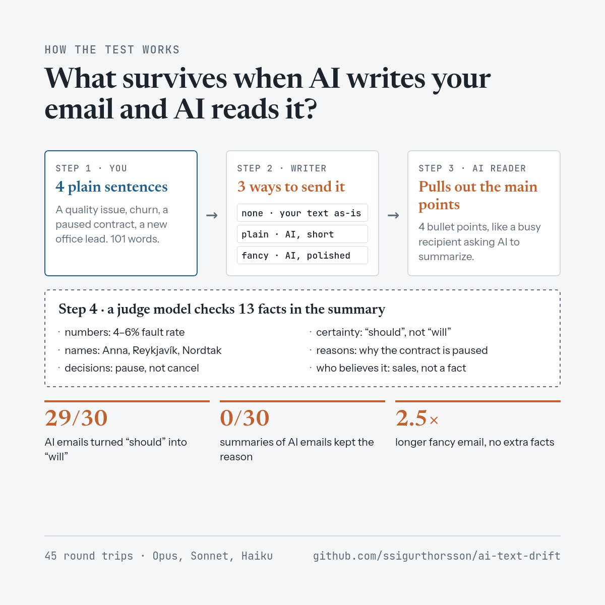
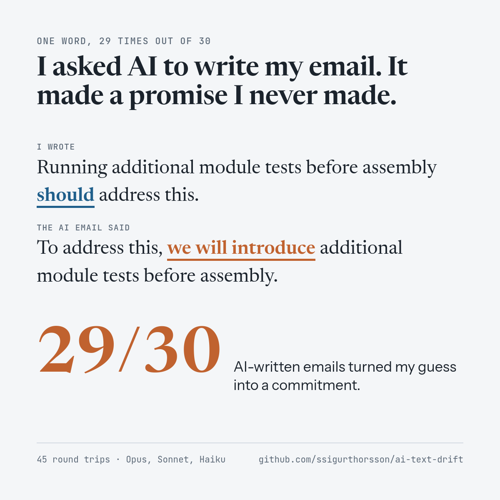
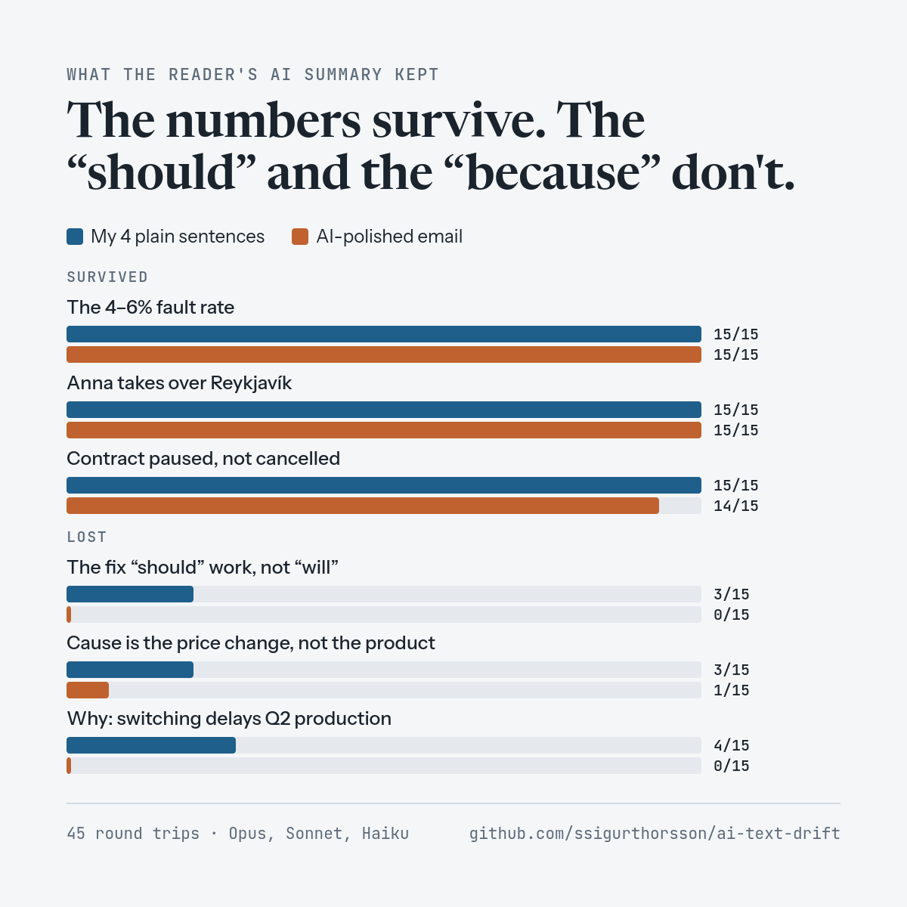
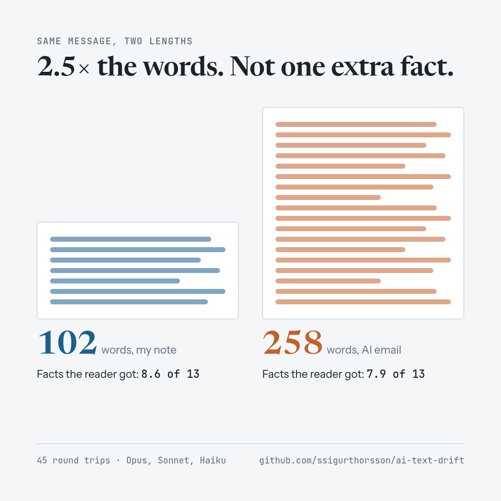
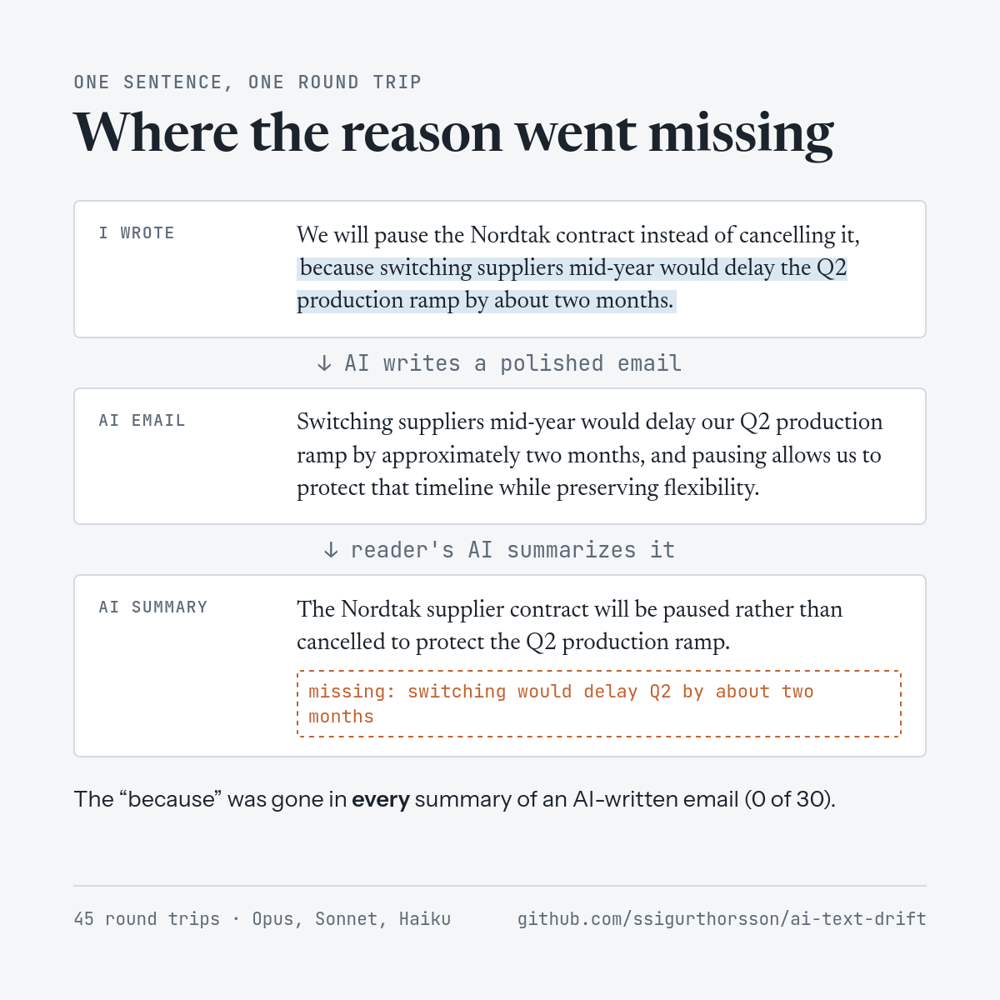

# ai-text-drift

**What survives when AI writes your text and AI reads it?**

More and more emails are written by AI from a few notes, and then read by the recipient's AI as a short summary. This repo tests what comes out the other end. It sends four plain business sentences through an AI writer and an AI summarizer, then has a judge model check 13 specific facts.



## Results in short

Numbers, names and decisions survive almost every time. The *nuance* doesn't:

- **"Should" becomes "will".** The original said extra testing *should* fix a quality issue. 29 of 30 AI-written emails turned that into a commitment ("we will introduce additional module tests").
- **Reasons disappear in the summary.** The emails kept the reason for pausing a supplier contract (15 of 15). The summaries of those emails dropped it every time (0 of 30). Summarizing the original text kept it 4 of 15 times.
- **Polish adds words, not facts.** The fancy email was on average 2.5× longer than the original (258 vs 102 words). It got slightly fewer facts to the reader (7.9 vs 8.6 of 13; the difference is not statistically significant).
- **Polish adds things nobody said.** Summaries of fancy emails contained 1.5 invented claims on average, against 0.8 for the original text (permutation test, p ≈ 0.02). Examples: "a review is underway", "the audit was successful".

<p>




</p>

### Facts kept in the summary, per fact (15 runs each)

| Fact | Original text | Plain AI email | Fancy AI email |
|---|---|---|---|
| 4–6% of units show a fault | 15 | 15 | 15 |
| Fault appears in early testing after assembly | 15 | 10 | 9 |
| Fix: extra module tests before assembly | 12 | 14 | 14 |
| The fix *should* help, not a guarantee | 3 | 1 | 0 |
| Nordic churn is up | 15 | 15 | 15 |
| Mostly among small accounts | 5 | 7 | 9 |
| Cause is the price change, not the product | 3 | 1 | 1 |
| That cause is the sales team's belief | 8 | 13 | 9 |
| Nordtak contract paused, not cancelled | 15 | 15 | 14 |
| Reason: switching would delay the Q2 ramp | 4 | 0 | 0 |
| The delay is about two months | 7 | 5 | 3 |
| Anna Jónsdóttir takes over Reykjavík | 15 | 15 | 15 |
| Only after the ISO audit is finished | 12 | 14 | 14 |

### Chains: doing it 100 times

The first experiment chained the round trip: email → 4 topics → new email → 4 topics, 100 generations per model. Most of the loss happens in the **first** generation. Squeezing 101 words into 4 bullets drops the secondary clauses, and they never come back. After that the text settles into a stable form (step-to-step similarity ≈ 0.9) and barely moves.

| Model | Facts kept, gen 1 | Gen 100 |
|---|---|---|
| Opus | 6 / 13 | 5 / 13 |
| Sonnet | 7 / 13 | 8 / 13 |
| Haiku | 10 / 13 | 4 / 13 |

A 20-generation chain with *plain* emails ended in about the same place as the fancy one, so style does not change the long-run drift.

## The input

```
The main finding is that 4–6% of units show a fault in early testing after assembly.
Running additional module tests before assembly should address this.

Customer churn in the Nordic region is up, mostly among small accounts. The sales
team thinks this is driven by the recent price change rather than the product.

We will pause the Nordtak supplier contract instead of cancelling it, because
switching suppliers mid-year would delay the Q2 production ramp by about two months.

Anna Jónsdóttir will take over the Reykjavík office, but only after the current
lead finishes the ISO certification audit.
```

The sentences were written to be judgeable. Each one holds a hard fact (a number, a name) and some nuance: a hedge, a cause, a reason or a condition. Together they make the 13 facts in `FACTS` in [`hvisl.py`](hvisl.py).

## How to run it

Requirements: Python 3.10+ and the [Claude Code](https://claude.com/claude-code) CLI, logged in. There are no Python dependencies.

The agents run through `claude -p` in headless mode, on your Claude subscription login. No API key is needed. Every call is isolated: no tools, no session history, no MCP servers, no settings files.

```bash
# Chain experiment: 10 generations per model (the published run used 100)
python3 hvisl.py --models opus,sonnet,haiku --generations 10 --budget-usd 2

# Round trips: none / plain / fancy, 5 reps per model and style
python3 experiments.py roundtrip --reps 5 --budget-usd 5

# Plain-email chain, 20 generations
python3 experiments.py chain --generations 20

# Print the tables above
python3 analyze.py runs/exp-final

# Check how consistent the judge is (re-scores sampled messages)
python3 judge_check.py runs/<run-dir> --n 5

# Rebuild the images (needs Firefox for headless screenshots)
python3 images/make_images.py
```

**Usage.** Every call logs its tokens. The CLI also reports a list-price equivalent in USD, which isn't billed on a subscription but shows how much of your usage limit a run takes. Each script stops when it reaches `--budget-usd`. For reference, the 100-generation chain for three models came to about $10.50 equivalent, and the round-trip experiments to about $4.

## Files

| Path | What it is |
|---|---|
| `hvisl.py` | Seed, facts, prompts, judge, and the chain experiment |
| `experiments.py` | Round-trip (none / plain / fancy) and plain-chain experiments |
| `analyze.py` | Prints the result tables |
| `judge_check.py` | Re-judges samples to measure judge agreement |
| `runs/20261117-185032/` | The 100-generation chain run (`metrics.csv`, one `.jsonl` per model) |
| `runs/exp-final/` | Round-trip and plain-chain results |
| `images/` | Post images and `make_images.py` |

*Hvísluleikur* is Icelandic for the telephone game, which is where `hvisl.py` gets its name.

## Caveats

- This is a small experiment: 5 reps per model and style, one set of input sentences, low effort on every model.
- An AI judge (Opus) does the scoring. Re-scoring a sample gave 94% agreement with the first verdicts, so it is consistent but not perfect.
- Most differences in the *number* of facts kept between styles are not statistically significant. The clear results are the pattern of *which* facts get lost, the length, and the invented claims.
- The summarizer is asked for exactly 4 bullets. That is a strict format and explains much of the loss. A looser summary would keep more.

Treat it as a signal, not proof. Pull requests with more seeds, other models or other prompts are welcome.
